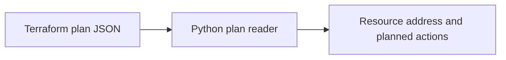

# Infra PR Risk Review

See what Terraform plans to create, update, replace, or delete before approving an infrastructure change. A Dockerized Python CLI reads Terraform plan JSON and prints one line per resource.

[View the automated tests and plan preview](https://github.com/taditharun/infra-pr-risk-review/actions/workflows/tests.yml)

## Architecture



You can run the reader with Python or use the Docker image, which packages Python, the reader, and the sample plan.

## Quick start

**Run with Python 3**

```bash
python3 src/read_plan.py fixtures/plan.json
```

**Run with Docker**

```bash
docker build -t infra-pr-risk-review:local .
docker run --rm --network none infra-pr-risk-review:local
```

Both ways produce the same sample output:

```text
aws_s3_bucket.demo: create
```

## Automated checks

```bash
python3 -m unittest discover -s tests -v
```

The test checks that the CLI prints the expected summary from the synthetic plan. GitHub Actions runs the test on pull requests and pushes to `main`, then shows the sample output on the run’s **Summary** page.

## Planned work

Add security scanner findings, Kubernetes manifest support, and review comments on pull requests.
